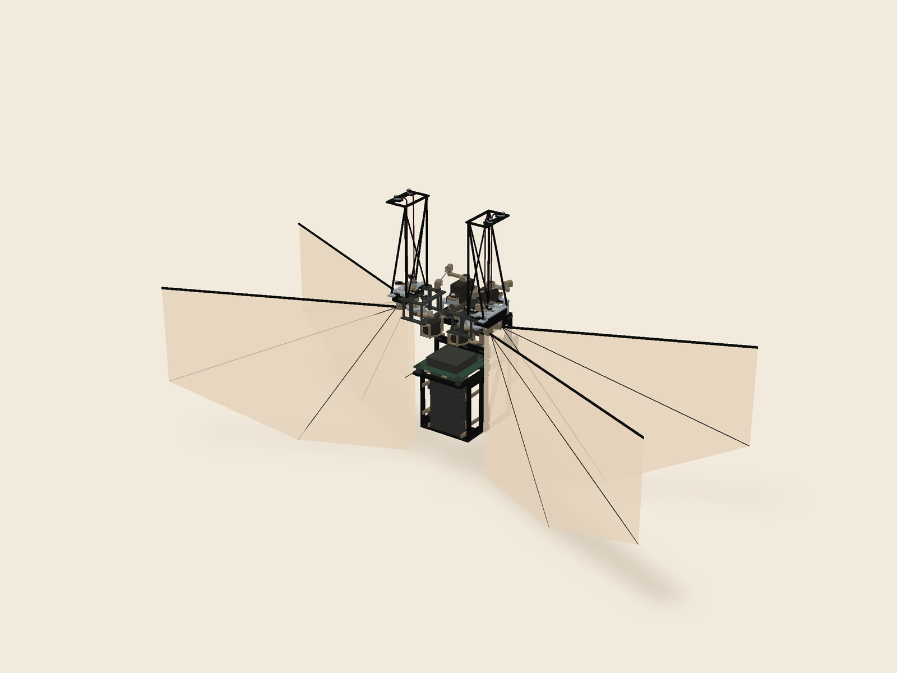

# Four wing flapping robot

**A compact mechanism, a fair spring comparison, and a bench designed to turn the remaining questions into measurements.**

I designed the transmission and its interfaces around four wings and two independent drives. The useful question became whether selectable springs offered enough extra benefit to justify their complexity.

One well chosen fixed spring captured almost all the calculated power benefit. That changed what I would prioritise in a physical prototype.

## What I worked on

- **Mechanism and packaging.** Four 140 mm wings, a roughly 330 mm design span, two 20:1 drives and a planning mass of about 42 g.
- **Interfaces that make the layout usable.** Root bearings, retained shafts, removable torsion bars, steering links, motor mounts, electrical provisions and assembly access.
- **A fair numerical comparison.** The same prescribed mission for no spring, a fixed spring and three selectable settings, including the less favourable results.
- **A way to measure it.** A located fixture, a proposed six axis sensor, a separate sensor removed proof arrangement and an enclosure layout.

This is computer designed and analysed work. Physical testing is the next stage.

## The result worth keeping

| Same prescribed mission | Calculated mean positive mechanical input power |
| --- | ---: |
| No spring | 2.144 W |
| Best fixed setting | 1.802 W |
| Three selectable settings | 1.798 W |

The fixed setting saves roughly **16% versus no spring**. Three settings add just **0.2% versus the best fixed setting**, about **3.6 mW**. That is a small budget for extra hardware, mass and friction. It is not an electrical or endurance result.

The first menu was actually 10.848 mW worse than the fixed setting. The retained evidence includes that comparison, all 1,694 stiffness and frequency samples and all 1,000 conditional scenarios. Nine scenarios favour the fixed setting. [Read the numerical evidence](docs/numerical-evidence.md).

## Explore the work

| Start here | What is inside |
| --- | --- |
| [Design story](docs/design-story.md) | Choices, interfaces and what changed my judgement |
| [Technical notes](docs/technical-notes.md) | Exact reference, assumptions, limits and bench qualification |
| [Exchange models](models/README.md) | Complete aircraft reference and bench assembly in millimetres |
| [Numerical readout](analysis/README.md) | Selected original data, working Python checks and regenerated plots |
| [Media guide](docs/media-specification.md) | Image sizes, palette and authentic prescribed motion |
| [Scope of this edition](docs/scope.md) | What this curated repository does and does not reproduce |

The motion clip is [available here](media/motion-light.mp4). Its [poster](media/motion-poster-light.webp) shows the same reference. Six seconds show two prescribed 20 Hz cycles at 60 times slower speed. Spring bars and wiring are omitted from the moving view because a valid deformation sequence is not available.

## Next step

I would qualify the bench in stages, measure the bars and fixture, establish sensor and drive limits, then measure torque and energy under controlled motion. The enclosure is not containment rated and its inspection view is not an operating configuration. The models are reference geometry, not authority to build or energise a test.

## Reuse

Copyright © 2026 Alen Mammen Varghese. Original software: [MIT](LICENSES/MIT.txt). Hardware: [CERN-OHL-P-2.0](LICENSES/CERN-OHL-P-2.0.txt). Original documents, data and media: [CC-BY-4.0](LICENSES/CC-BY-4.0.txt). See [LICENSING.md](LICENSING.md) and [NOTICE.md](NOTICE.md) for the allocation and retained third party notices.

[My portfolio](https://varghese-alen.github.io/)
